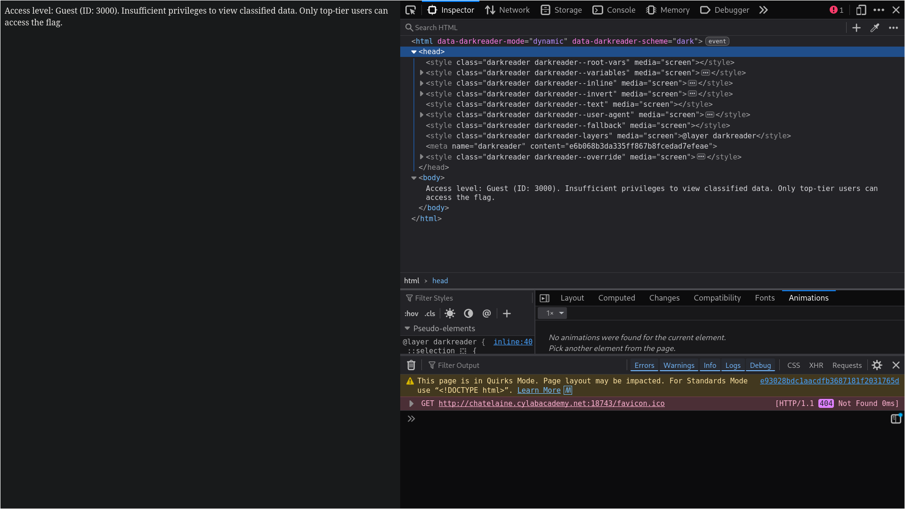
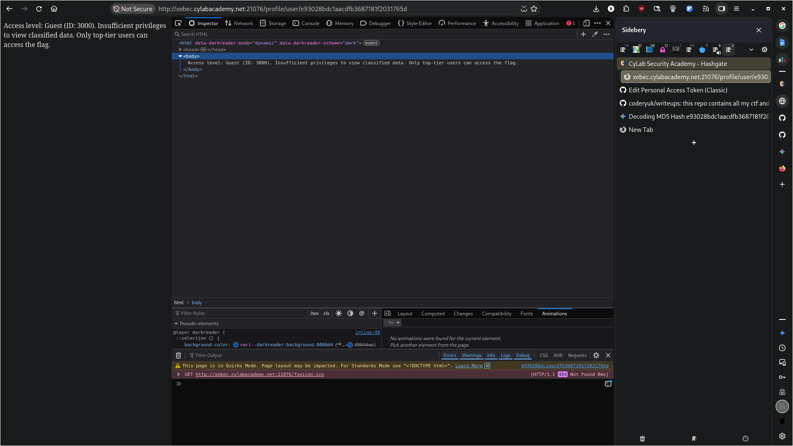

# [hashgate]

- **Event:** picoCTF
- **Category:** [web]
- **Difficulty:** [M]

---

## Challenge Description

You have gotten access to an organisation's portal. Submit your email and password, and it redirects you to your profile. But be careful: just because access to the admin isn’t directly exposed doesn’t mean it’s secure. Maybe someone forgot that obscurity isn’t security... Can you find your way into the admin’s profile for this organisation and capture the flag?

---

## workflow

checking the source code of the website


### Key Findings

```html
<!-- Email: guest@cylabacademy.org Password: guest -->
```

---

using these login details we got



we get ---- Access level: Guest (ID: 3000). Insufficient privileges to view classified data. Only top-tier users can access the flag.



we can see that i the website is using the user/----hash to get the webpage back

i know this is md5 hash (found this by asking gemini what was the value that was encoded and it replied that it is not encoded but is md5 hash of 3000 which was the user that we were assigned)

by this login we can take any number (that may be a user or a admin) get its hash put it in the url and then find the webpage results directly without needing to sign in or know any passwords

doing this manually is going to take for ever

now i am going to learn how to write a python script that can do this automatically for different number ranges

i made these 2 python script but they calculated it for users between 1 and 3000 and i got no request

[urlhash.py python script 1](tools/urlhash.py)
[urlhash2.py python script 2](tools/urlhash2.py)

this final script checked for users beyond 3000 and this returned me the admin page
[urlhash3.py python script 3](tools/urlhash3.py)


this page contained the final flag
