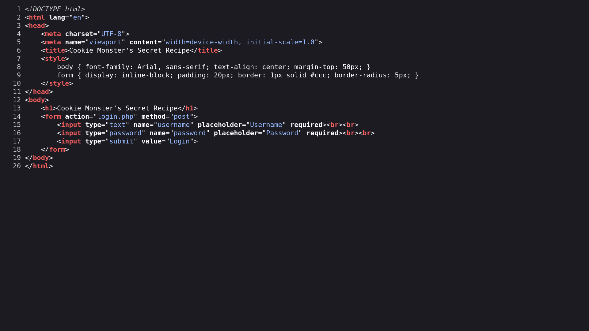

# [Challenge Name]

- **Event:** picoCTF
- **Category:** [web]
- **Difficulty:** [D]

---

## Challenge Description

You have gotten access to an organisation's portal. Submit your email and password, and it redirects you to your profile. But be careful: just because access to the admin isn’t directly exposed doesn’t mean it’s secure. Maybe someone forgot that obscurity isn’t security... Can you find your way into the admin’s profile for this organisation and capture the flag?

---

## workflow

checking the source code of the website



### Key Findings

putting in fake values to login just to see what would happen i saw that /login.php page just hinted to check my cookies

```html
<h1>Access Denied</h1>
<p>Cookie Monster says: 'Me no need password. Me just need cookies!'</p>
<p>Hint: Have you checked your cookies lately?</p>
<a href="/">Go back</a>
```

---


on first when i checked the cookies in the network tab i couldnt notice anything by on seeing the post request being send i checked its cookies value to notice == at the end this could mean that the cookie might be encoded so i checked for it on CyberChef with base64 to get the flag directly


