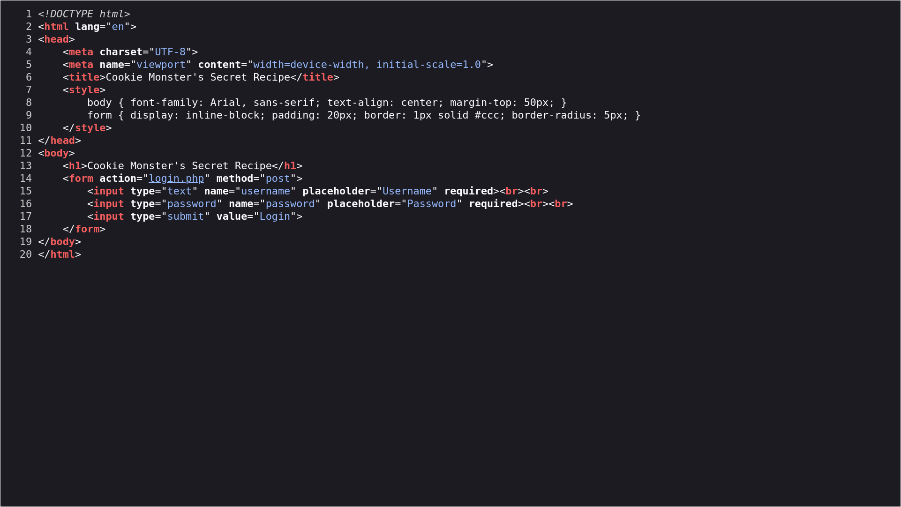
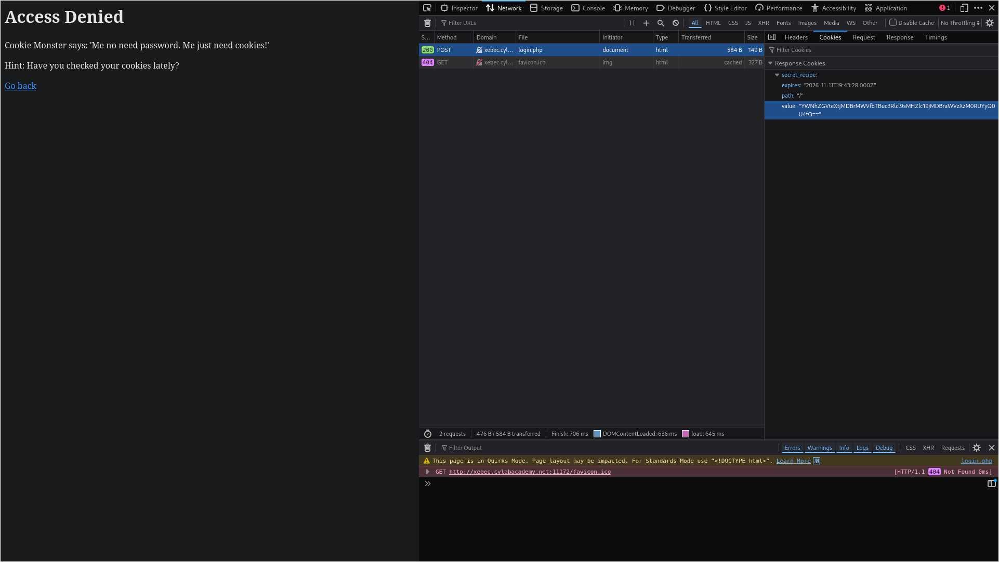
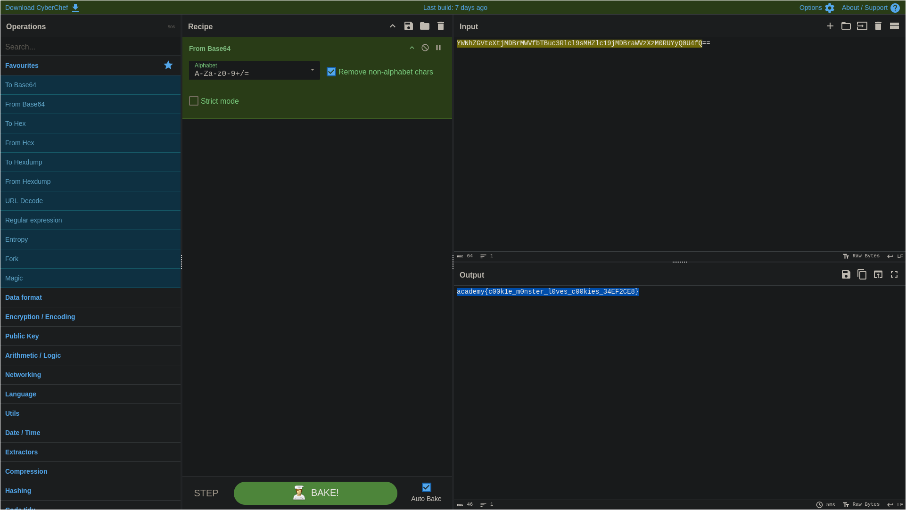

# [Challenge Name]

- **Event:** picoCTF
- **Category:** [web]
- **Difficulty:** [E]
- **Target / Instance:** `http://...` or `nc ...`

---

## Challenge Description

Cookie Monster has hidden his top-secret cookie recipe somewhere on his website. As an aspiring cookie detective, your mission is to uncover this delectable secret. Can you outsmart Cookie Monster and find the hidden recipe?

---

## workflow

checking the source code of the website



### Key Findings

putting in fake values to login just to see what would happen i saw that /login.php page just hinted to check my cookies

```html
<h1>Access Denied</h1>
<p>Cookie Monster says: 'Me no need password. Me just need cookies!'</p>
<p>Hint: Have you checked your cookies lately?</p>
<a href="/">Go back</a>
```

---



on first when i checked the cookies in the network tab i couldnt notice anything by on seeing the post request being send i checked its cookies value to notice == at the end this could mean that the cookie might be encoded so i checked for it on CyberChef with base64 to get the flag directly


